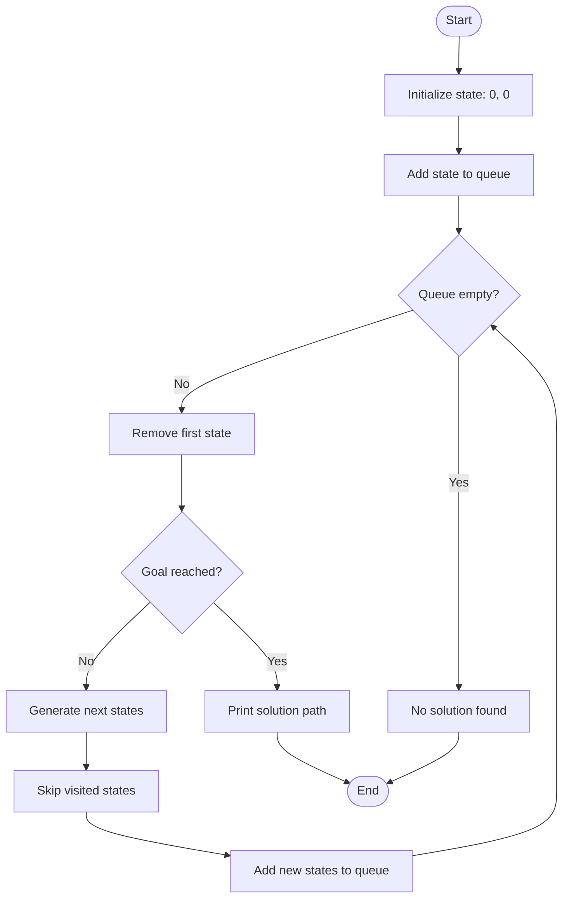

 <div align="center">

# 💧 AI WATER JUG SOLVER

### Think Smart. Pour Strategically. Solve with AI.

A classic Artificial Intelligence problem solved using **Breadth-First Search (BFS)** in Python, with step-by-step water-level visualization.


**Can AI measure exactly 2 litres using two unmarked water jugs? Let's find out! 🧠**

</div>

---

## 🌟 Project Overview

The **AI Water Jug Solver** is a beginner-friendly Python project that demonstrates how Artificial Intelligence can solve a state-space search problem.

The task is to measure exactly **2 litres of water** using two unmarked jugs with capacities of 4 litres and 3 litres. The program explores possible states using Breadth-First Search and finds a sequence of actions that reaches the goal.

It also visualizes the water levels at every step using Matplotlib.

## 🎯 Problem Statement

You are given:

- 🪣 **Jug A:** Capacity of 4 litres
- 🪣 **Jug B:** Capacity of 3 litres
- 💧 **Water supply:** Unlimited
- 🎯 **Goal:** Measure exactly 2 litres in either jug

Allowed operations:

1. Fill Jug A completely.
2. Fill Jug B completely.
3. Empty Jug A.
4. Empty Jug B.
5. Pour water from Jug A into Jug B.
6. Pour water from Jug B into Jug A.

The challenge is to reach the goal with the fewest actions.

## 🎬 Project in Action

### Water Jug Visualization

The program draws both jugs and updates their water levels after every action.


**Visualization legend**

| Element | Meaning |
|---|---|
| 🪣 Jug A | Maximum capacity: 4 litres |
| 🪣 Jug B | Maximum capacity: 3 litres |
| 🟦 Blue water | Current amount of water |
| 🎯 Goal | Exactly 2 litres in either jug |

> Add your screenshot to the `assets` folder with the filename `water-jug-initial.png` so it appears on the GitHub page.

## 🧠 AI Concept: State-Space Search

The problem is represented using a state:

`(x, y)`

Where:

- `x` is the amount of water in Jug A.
- `y` is the amount of water in Jug B.

Examples:

| State | Meaning |
|---|---|
| `(0, 0)` | Both jugs are empty |
| `(4, 0)` | Jug A is full |
| `(0, 3)` | Jug B is full |
| `(2, 0)` | Goal reached |

**Initial state:** `(0, 0)`

**Goal condition:** `x == 2` or `y == 2`

Each allowed operation produces a new state. BFS searches through these states until it finds one satisfying the goal condition.

## 🔍 How BFS Works

Breadth-First Search explores states level by level using a queue.

1. Start with both jugs empty.
2. Add the initial state to the queue.
3. Remove the oldest state from the queue.
4. Check whether the goal has been reached.
5. Generate the valid next states.
6. Skip states that have already been visited.
7. Add new states to the queue.
8. Repeat until the goal is found or no states remain.

### BFS Flowchart



## ✨ Features

- 🧠 BFS-based state-space search
- 💧 Two-jug water measurement problem
- 🔄 Fill, empty, and pour operations
- 🔍 Visited-state tracking to avoid repeated exploration
- 🛤️ Solution-path reconstruction
- 📊 Step-by-step terminal output
- 🎨 Matplotlib water-level visualization
- 👣 Total action count

## 🛠️ Tech Stack

| Technology | Purpose |
|---|---|
| Python | Main implementation |
| `collections.deque` | BFS queue |
| Matplotlib | Water-jug visualization |
| `matplotlib.patches.Rectangle` | Drawing jug outlines and water levels |

## 🚀 Getting Started

### Prerequisites

- Python 3.10 or newer recommended
- VS Code or another Python editor
- Git, if cloning the repository

### 1. Clone the repository

```bash
git clone https://github.com/Prachipandey28/AI-Water-Jug-Solver.git
cd AI-Water-Jug-Solver
```

Replace the URL if your repository has a different name or location.

### 2. Install the dependency

```bash
python3 -m pip install matplotlib
```

### 3. Run the program

```bash
python3 main.py
```

The program prints each action and opens a visualization window for each step. Close the current window to continue to the next step.

## 📊 Sample Output

The exact sequence depends on the order in which the possible actions are explored.

```text
========================================
       AI WATER JUG SOLVER
========================================
Jug A capacity: 4 litres
Jug B capacity: 3 litres
Target amount: 2 litres

Initial State: (0, 0)

========== SOLUTION ==========

Step 1: Fill Jug A
State: (4, 0)

Step 2: Pour A -> B
State: (1, 3)

Step 3: Empty Jug B
State: (1, 0)

Step 4: Pour A -> B
State: (0, 1)

Step 5: Fill Jug A
State: (4, 1)

Step 6: Pour A -> B
State: (2, 3)

========== RESULT ==========
Goal reached!
Final state: (2, 3)
Total actions: 6
```

The sample above illustrates one valid solution. The exact path and action count produced by your code may differ depending on the search implementation and goal-checking rules.

## 📁 Project Structure

```text
AI-Water-Jug-Solver/
│
├── main.py
├── README.md
└── assets/
    └── water-jug-initial.png
```

## 🎓 Learning Outcomes

By completing this project, you practice:

- Representing a problem as states
- Defining initial and goal states
- Generating valid state transitions
- Using a queue for BFS
- Tracking visited states
- Reconstructing a solution path
- Visualizing an AI search solution
- Understanding how AI solves classical problems

## 🔮 Future Enhancements

- [ ] Animate water levels in a single window.
- [ ] Allow users to change jug capacities and target amount.
- [ ] Display the explored state-space tree.
- [ ] Compare BFS with DFS.
- [ ] Add a graphical user interface.
- [ ] Record the number of explored states and execution time.
- [ ] Add more screenshots and a demonstration video.

## 👩‍💻 Author

**Prachi Pandey**

GitHub: [@Prachipandey28](https://github.com/Prachipandey28)

---

<div align="center">

### ⭐ Found this project interesting?

Explore the code, learn the fundamentals of AI search, and consider starring the repository!

**Built with Python, logic, and a little water-powered AI magic. 💧🧠**

</div>